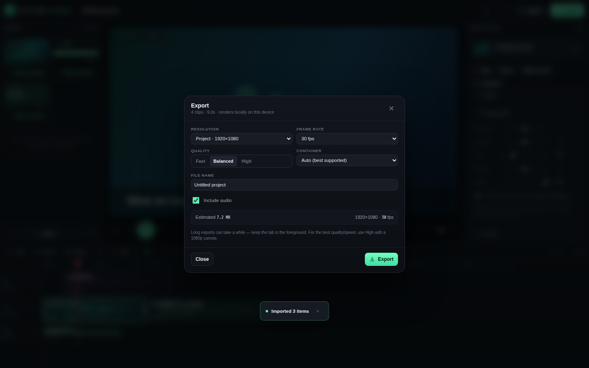

# Cutline Studio

A touch-first, browser-native video editor. Import, cut, trim, grade, title, mix, and export — all on your device, with no upload and no account.

**Status: v0.1 — working MVP.** This is a real editing engine and a real export pipeline, not a mockup. It is deliberately shaped like a professional NLE (multi-track timeline, keyframes, transitions, WebCodecs export), but it is **not yet at Premiere / DaVinci parity** — see the roadmap for the honest gap list.


---

## Quick start

```bash
npm install
npm run dev          # http://localhost:5173
# or a production build:
npm run build
npm run preview      # http://localhost:5173
```

Open that URL on the same machine, or on a phone connected to the same network
(`http://<computer-ip>:5173`). On Android Chrome you can use **Add to Home screen** —
the production build registers a service worker and runs offline.

Everything stays in the browser: media is read with object URLs, audio is decoded with
Web Audio, and the project autosaves to IndexedDB. Nothing is uploaded.

### Phone notes

- The UI is mobile-first: preview on top, timeline at the bottom, and **Media / Edit / Export** sheets.
- Import with the system file picker; files stay on-device.
- Tap a media card to drop it at the playhead, or drag it onto a specific track.
- Export runs locally through WebCodecs. On Android Chrome it can usually write **MP4 (H.264 + AAC)**;
  elsewhere it falls back to **WebM (VP9 + Opus)** automatically.
- Keep the tab in the foreground while exporting; long renders are CPU-bound.

---

## What it does today

**Editing**
- Unlimited video/audio tracks, 4K/vertical/square canvas presets, 24–60 fps.
- Drag, trim from either edge, split at the playhead, delete or ripple-delete.
- Magnetic snapping to clip edges and the playhead; locked tracks; mute/hide.
- Frame stepping, timeline scrubbing, scrubbing while paused, auto-scroll during playback.
- Undo/redo with 50 steps, per-gesture history (a drag is one undo step).

**Look**
- Per-clip transform (position, scale, rotation, opacity), fit or fill-frame.
- Keyframes on position, scale, rotation, opacity, and volume, with smooth interpolation.
- Colour grade: exposure, contrast, saturation, temperature, hue, blur, vignette.
- Ten transitions: dissolve, dip to black/white, four wipes, two slides, iris —
  with automatic audio crossfades.

**Titles**
- Vector title clips rendered at export resolution: font size, colour, backdrop
  colour/opacity, padding, alignment, bold, shadow, plus transform/keyframes.

**Audio**
- Web Audio mixdown with per-clip volume, fades, speed, track mute, and transition crossfades.
- Automatic audio decode on import; waveform thumbnails in the bin and on the timeline.

**Delivery**
- WYSIWYG export using the *same* compositor as the preview.
- MP4 (H.264/AAC) or WebM (VP9/Opus), automatic codec fallback, 720p → 4K.
- Progress, cancel, "Download again", and native sharing where supported.
- Autosave and session restore; projects survive a reload.
- Installable PWA with offline shell; everything works with no network.

| Desktop | Phone |
| --- | --- |
|  |  |



---

## Keyboard shortcuts

| Action | Shortcut |
| --- | --- |
| Play / pause | `Space` |
| Split at playhead | `S` or `Ctrl/Cmd+K` |
| Delete / ripple delete | `Delete` / `Shift+Delete` |
| Duplicate clip | `Ctrl/Cmd+D` |
| Add title | `T` |
| Undo / redo | `Ctrl/Cmd+Z` / `Ctrl/Cmd+Shift+Z` |
| Step a frame | `←` / `→` (add `Shift` for 1 s) |
| Start / end | `Home` / `End` |
| Zoom timeline | `+` / `-`, or `Ctrl/Cmd` + wheel |

---

## How it is built

```
src/
  core/        types, pure project model, placement helpers
  state/       zustand store: projects, selection, history, gestures
  media/       import, metadata + duration probing, thumbnails, audio decode, peaks
  render/      Canvas2D compositor (transforms, grade, transitions, titles)
  audio/       Web Audio playback clock, scheduling, offline mixdown
  export/      WebCodecs video/audio encoders + mp4-muxer / webm-muxer
  persistence/ IndexedDB autosave
  ui/          React app shell, timeline, preview, inspector, export dialog
```

Key ideas:

1. **One compositor for preview and export.** `drawFrame()` is resolution-independent;
   preview renders at ≤1280 px, export renders at the target size. WYSIWYG by construction.
2. **Audio-clocked playback.** Audio is decoded into `AudioBuffer`s and scheduled against
   `AudioContext.currentTime`; the playhead is derived from that clock, so A/V stays in sync.
   Muted `<video>` elements are used only as textures, nudged when they drift.
3. **Seek-based deterministic export.** Every frame seeks its sources, draws, then feeds a
   `VideoFrame` to `VideoEncoder`. Audio is mixed in an `OfflineAudioContext`, encoded to
   AAC or Opus, and muxed into MP4/WebM.
4. **Pure model + gesture history.** Project mutations are immutable; drags open a gesture
   and commit one history entry on release, so undo behaves the way editors expect.
5. **Honest fallbacks.** No WebCodecs → the export dialog explains it instead of failing silently.
   No AAC → WebM. No duration metadata in a WebM → probe by seeking to the end.

### Verification

`npm run test:smoke` drives a real Chromium build end-to-end: it generates a test clip,
tone, and still in-browser, imports them, plays, splits, undoes, drags, trims, adds a
transition, exports, decodes the exported file's video/audio, reloads to test autosave,
and checks the mobile layout. `node tests/features.mjs` covers titles, decimal inputs,
duplicate/undo, and persistence.

Latest run against the production build: **all checks passing** — 24 smoke checks
(including offline reload and exported A/V decode), 9 feature checks, and 12 mobile/landscape
layout checks. Reports are written to `test-results/`.

```bash
npm test   # smoke + features + mobile (needs a Playwright Chromium; set CHROME_PATH to override)
```

---

## Known limits (read this)

- **Not parity yet.** No GPU pipeline, no LUTs, no masks/tracking, no captions, no
  multicam, no proxy media, no collaboration, no HDR/colour management.
- Preview is capped at 1280 px internally; export still renders at full target resolution.
- Transitions require the clips to be adjacent on the same track; audio uses source
  handles, so a transition may shorten to the available audio.
- Long WebM exports decode source audio fully in memory. Very large projects may need
  a desktop browser.
- One autosaved project per browser profile. Clearing site data deletes the project and
  its media; there is no backup bundle yet.
- MP4/H.264/AAC availability is browser- and device-dependent. The app detects support
  and falls back, but a browser without WebCodecs (older Safari) cannot export.

---

## Roadmap to "top-tier"

**P0 — trust and speed**
- Backup/restore project bundles (zip with media), relink, cloud-free sync.
- GPU compositor (WebGL2/WebGPU) for blend modes, LUTs, masks, and 60 fps 4K preview.
- Proxy generation + background thumbnail/waveform workers.
- Per-clip crop rectangle, speed curves, freeze frames, reverse.

**P1 — CapCut-level ease**
- Auto-captions (on-device Whisper), text templates, auto-reframe (subject tracking).
- Beat detection and auto-cut to music, silence removal, scene detection.
- Sticker/emoji overlays, transitions library with presets, social aspect presets.

**P2 — professional depth**
- Curve-based colour grading, scopes (waveform/vectorscope), LUT import, HDR.
- Multicam, nested sequences/adjustment layers, motion tracking and stabilisation.
- Audio bus, EQ/compressor/denoise, ducking, 5.1.
- Team projects, review links, comments, version history.

**Packaging**
- The same codebase can be wrapped for Windows/macOS with Tauri (preferred: smaller,
  native FFmpeg available) or Electron. The browser version remains the source of truth;
  a native shell adds real FFmpeg encode/decode, filesystem project files, and native
  GPU access. This has **not** been built or verified in this environment (no Rust/FFmpeg
  toolchain here) — it is the next milestone, not a current feature.

---

## Why browser-first

Running Windows on an Android phone through emulation is not viable for video editing:
no GPU video path, no reliable codec support, and unusable performance. The browser is
the pragmatic common denominator — it runs on the phone today, installs as a PWA, and
the identical UI can be wrapped as a Windows desktop app later without a rewrite.

---

Built with React 19, TypeScript, Vite, zustand, `mp4-muxer`, and `webm-muxer`.
No analytics, no telemetry, no network calls at runtime.