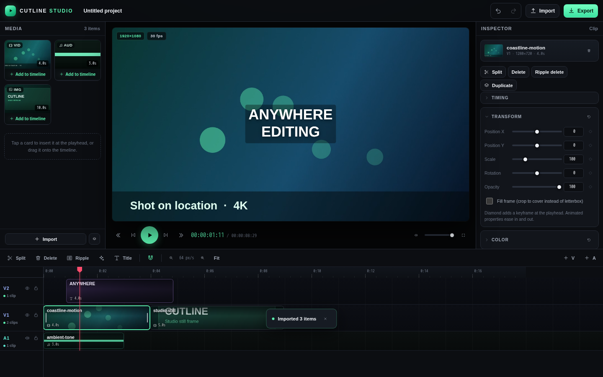
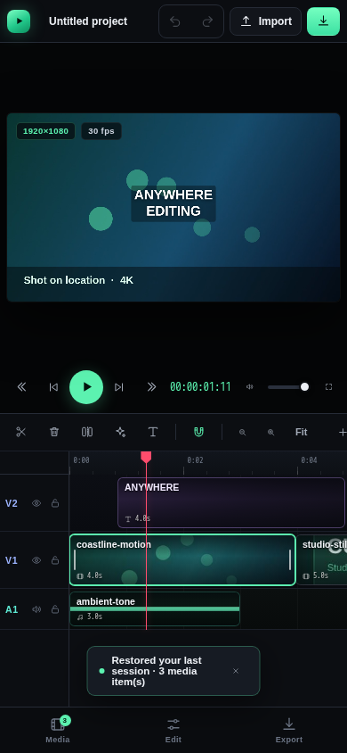
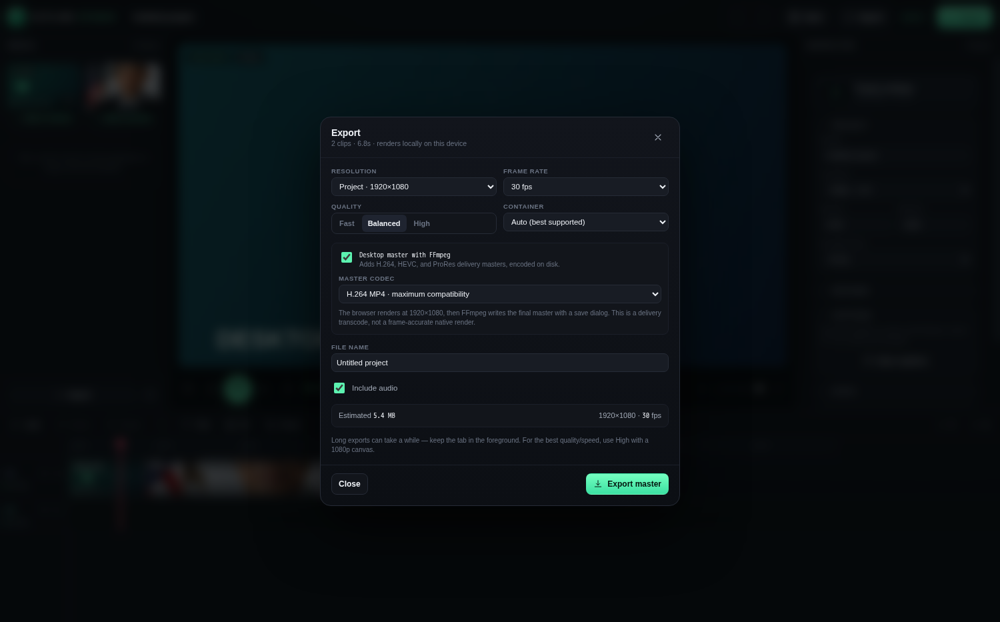
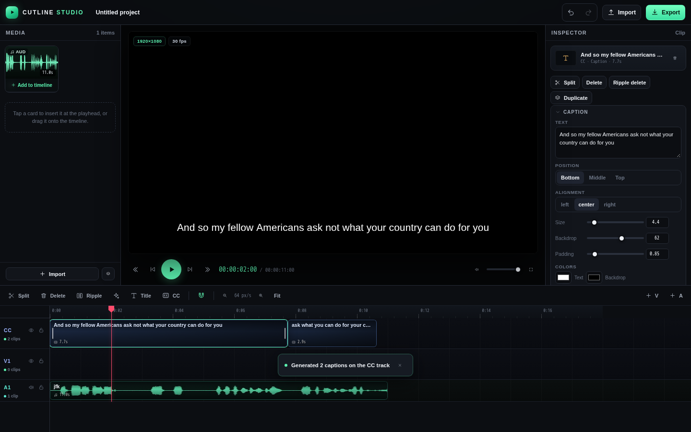
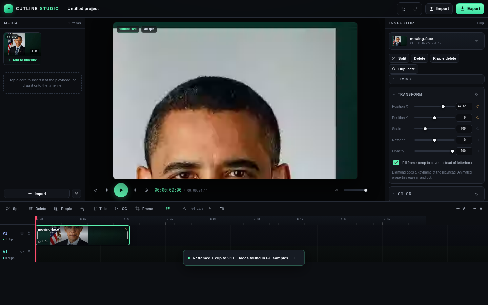

# Cutline Studio

A touch-first, browser-native video editor. Import, cut, trim, grade, title, mix, and export — all on your device, with no upload and no account.

**Status: v0.5 — two builds from one engine, now with a DaVinci-style colour page (GPU grading, LUTs, scopes, wheels).** This is a real editing engine and a real export pipeline, not a mockup. It is deliberately shaped like a professional NLE (multi-track timeline, keyframes, transitions, WebCodecs export), but it is **not yet at Premiere / DaVinci parity** — see the roadmap for the honest gap list.



---

## Two builds, one engine

| | **Cutline Light** | **Cutline Heavy (desktop)** |
| --- | --- | --- |
| Runs on | Phone, tablet, any browser, installed PWA | Windows / macOS / Linux desktop |
| Media | Picked into browser memory | **Streamed from disk** with range seeking |
| Projects | One autosaved workspace (IndexedDB) | **`.cutline` files**, last project reopens, crash autosave |
| Export | WebCodecs (MP4 when supported, else WebM) | WebCodecs render **+ FFmpeg masters**: H.264, HEVC, ProRes |
| Footprint | 42 MB lazy-loaded bundle | ~420 MB installed (Electron + FFmpeg) |
| Best for | Capture-to-post on a phone, quick edits | Long footage, guaranteed codecs, delivery masters |

The desktop app is additive: it loads the same UI and editor, then adds native capabilities through a
small IPC bridge. The web build remains zero-install and unchanged.

## The professional pillars

| Pillar | Today | Next |
| --- | --- | --- |
| **Edit** | Multi-track timeline, trim/split/ripple delete, snapping, keyframes, undo | Roll / slip / slide, J/L cuts, multi-select, insert/overwrite, multicam, nested sequences |
| **Color** | GPU primary grade, lift/gamma/gain wheels, 3D LUTs, live scopes, bypass | Curves, HSL qualifier, power windows, node graph, keyframed grades, HDR |
| **Audio** | Clip gain, fades, transition crossfades, offline mixdown | EQ, compressor, buses, ducking, 5.1, waveform repair |
| **Effects** | Ten transitions, auto-reframe, titles, captions | Keying, masks, motion tracking, Fusion-style node effects |
| **Media** | Disk streaming, `.cutline` projects, autosave | Proxies, bundles/relink, background workers, media library |
| **Delivery** | WebCodecs + FFmpeg H.264/HEVC/ProRes masters | Render queue, presets, watch folders, background export |

This is the honest shape of "DaVinci + Premiere": each pillar needs real engineering. The app is
built so pillars can land independently on the same project model and renderer.


## Quick start

```bash
npm install
npm run dev          # http://localhost:5173
# or a production build:
npm run build
npm run preview      # http://localhost:5173
```

Open that URL on the same machine, or on a phone connected to the same network
(`http://<computer-ip>:5173`). On Android Chrome you can use **Add to Home screen** —
the production build registers a service worker and runs offline.

### Heavy desktop build

```bash
npm install
npm run desktop:start        # builds the web bundle, opens the Electron app
```

Live-reload development (two terminals):

```bash
npm run dev
# Linux / macOS
CUTLINE_DEV_URL=http://127.0.0.1:5173 npx electron .
# Windows PowerShell
$env:CUTLINE_DEV_URL="http://127.0.0.1:5173"; npx electron .
```

Or package it:

```bash
npm run desktop:build        # unpacked app for the current OS (release/)
npm run desktop:dist:win     # Windows NSIS installer (run on Windows)
npm run desktop:dist:linux   # Linux AppImage (run on Linux)
```

On Windows, build a **portable folder** or an installer:

```powershell
npm ci
npm run build
npm run desktop:pack:win    # release/win-unpacked/Cutline Studio.exe (portable)
npm run desktop:dist:win    # release/Cutline-Studio-<version>-Setup.exe (installer)
```

The GitHub Actions workflow in `.github/workflows/windows-build.yml` also produces an
installer artifact from `windows-latest`. Builds are **unsigned**, so SmartScreen warns
(“More info” → “Run anyway”). The portable folder is ~560 MB extracted (Electron 45 +
FFmpeg); the zip is smaller.

### Windows smoke checklist

Run this on the Windows machine before trusting it with a project:

1. Extract the whole portable zip and launch `Cutline Studio.exe`.
2. **File → Import Media**: a long MP4/MOV; scrub and play; confirm audio.
3. **File → Save Project**, quit, relaunch: the project should reopen; autosave recovers.
4. **Export** with **Desktop master with FFmpeg**: H.264, then ProRes; play both files.
5. Colour page: import a `.cube` LUT, confirm scopes draw and the grade is in the export.
6. Report the exact error text and Windows version if anything fails.

Desktop-only behaviour:
- **File → Import Media** streams files from disk; nothing is copied into the app.
- **File → Save / Save As** writes a `.cutline` JSON project that references the source files
  by absolute path. **File → Open** and launch restore reopen it; autosave lives in the app
  data folder and recovers after a crash.
- **Export → Desktop master with FFmpeg** renders in the browser, then writes H.264, HEVC, or
  ProRes with a native save dialog. `Show in folder` reveals the result.
- Native menus, `Ctrl+S` / `Ctrl+O` / `Ctrl+I`, and a window title follow the project.

Heavy v1 caveats: the master is a **transcode of the browser render**, not a frame-accurate
native pipeline (generation loss is possible). Projects reference source paths rather than
bundling media, so moving a project requires the media to stay in place. Proxies, a render
queue, and multicam are not in this build yet. FFmpeg's GPL build (x264/x265) has distribution
implications — see *Third-party assets*.

Everything stays in the browser: media is read with object URLs, audio is decoded with
Web Audio, and the project autosaves to IndexedDB. Nothing is uploaded.

### Phone notes

- The UI is mobile-first: preview on top, timeline at the bottom, and **Media / Edit / Export** sheets.
- Import with the system file picker; files stay on-device.
- Tap a media card to drop it at the playhead, or drag it onto a specific track.
- Export runs locally through WebCodecs. On Android Chrome it can usually write **MP4 (H.264 + AAC)**;
  elsewhere it falls back to **WebM (VP9 + Opus)** automatically.
- Keep the tab in the foreground while exporting; long renders are CPU-bound.

---

## What it does today

**Editing**
- Unlimited video/audio tracks, 4K/vertical/square canvas presets, 24–60 fps.
- Drag, trim from either edge, split at the playhead, delete or ripple-delete.
- Magnetic snapping to clip edges and the playhead; locked tracks; mute/hide.
- Frame stepping, timeline scrubbing, scrubbing while paused, auto-scroll during playback.
- Undo/redo with 50 steps, per-gesture history (a drag is one undo step).

**Look**
- Per-clip transform (position, scale, rotation, opacity), fit or fill-frame.
- Keyframes on position, scale, rotation, opacity, and volume, with smooth interpolation.
- Colour grade: exposure, contrast, saturation, temperature, hue, blur, vignette.
- Ten transitions: dissolve, dip to black/white, four wipes, two slides, iris —
  with automatic audio crossfades.

**Titles & captions**
- Vector title clips rendered at export resolution: font size, colour, backdrop
  colour/opacity, padding, alignment, bold, shadow, plus transform/keyframes.
- **On-device auto-captions** with Whisper tiny (English): transcribes the timeline
  locally, creates editable cues on a dedicated CC track, and downloads the ~41 MB
  model once. Nothing is uploaded.
- Manual cues, .srt import/export, caption position (bottom/middle/top), restyling,
  and the same keyframe/transform toolkit as titles.

**Color page**
- **GPU grade** per clip: lift / gamma / gain colour wheels, exposure, contrast,
  saturation, temperature, hue, vignette, blur — preview and export share the same shader.
- **3D LUTs**: import `.cube` files, blend with the mix control, and keep them in the project.
  Built-ins include Monochrome, Teal & Orange, Warm/Cool Film, and Faded Matte.
- **Live scopes**: RGB waveform, vectorscope, and histogram sampled from the viewer.
- **Viewer bypass** for before/after, plus a reset and a dedicated Color workspace on desktop
  and a bottom sheet on phones that keeps the preview visible.
- Requires WebGL2 for LUTs and wheels; without it the basic sliders fall back to Canvas2D filters.

**Reframing**
- **Auto-reframe** to 9:16, 4:5, 1:1, or 16:9: detects faces on-device (BlazeFace),
  fills the new canvas, and keyframes the pan so the subject stays in shot.
- One undo restores the previous canvas and framing. Locked tracks are left alone,
  text/caption cues are preserved.
- Centre-crop fallback when no face is found or the detector is unavailable.

**Audio**
- Web Audio mixdown with per-clip volume, fades, speed, track mute, and transition crossfades.
- Automatic audio decode on import; waveform thumbnails in the bin and on the timeline.

**Delivery**
- WYSIWYG export using the *same* compositor as the preview.
- MP4 (H.264/AAC) or WebM (VP9/Opus), automatic codec fallback, 720p → 4K.
- Progress, cancel, "Download again", and native sharing where supported.
- Autosave and session restore; projects survive a reload.
- Installable PWA with offline shell; everything works with no network.

| Desktop | Phone |
| --- | --- |
|  |  |










---

## Keyboard shortcuts

| Action | Shortcut |
| --- | --- |
| Play / pause | `Space` |
| Split at playhead | `S` or `Ctrl/Cmd+K` |
| Delete / ripple delete | `Delete` / `Shift+Delete` |
| Duplicate clip | `Ctrl/Cmd+D` |
| Add title | `T` |
| Captions panel | `C` |
| Auto-reframe | `R` |
| Undo / redo | `Ctrl/Cmd+Z` / `Ctrl/Cmd+Shift+Z` |
| Step a frame | `←` / `→` (add `Shift` for 1 s) |
| Start / end | `Home` / `End` |
| Zoom timeline | `+` / `-`, or `Ctrl/Cmd` + wheel |

---

## How it is built

```
src/
  core/        types, pure project model, placement helpers
  state/       zustand store: projects, selection, history, gestures
  media/       web + native import, metadata probing, thumbnails, audio, peaks
  render/      Canvas2D compositor (transforms, grade, transitions, titles)
  audio/       Web Audio playback clock, scheduling, offline mixdown
  export/      WebCodecs video/audio encoders + mp4-muxer / webm-muxer
  captions/    Whisper ASR wrapper, SRT parser/formatter
  reframe/     BlazeFace wrapper, framing math, keyframe planning
  desktop/     renderer bridge + project serialization for the heavy shell
  persistence/ IndexedDB autosave (web)
  ui/          React app shell, timeline, preview, inspector, dialogs

desktop/
  main.cjs     Electron main: app/menus, cutline:// protocols, project + FFmpeg IPC
  preload.cjs  context-isolated native bridge
```

Key ideas:

1. **One compositor for preview and export.** `drawFrame()` is resolution-independent;
   preview renders at ≤1280 px, export renders at the target size. WYSIWYG by construction.
2. **Audio-clocked playback.** Audio is decoded into `AudioBuffer`s and scheduled against
   `AudioContext.currentTime`; the playhead is derived from that clock, so A/V stays in sync.
   Muted `<video>` elements are used only as textures, nudged when they drift.
3. **Seek-based deterministic export.** Every frame seeks its sources, draws, then feeds a
   `VideoFrame` to `VideoEncoder`. Audio is mixed in an `OfflineAudioContext`, encoded to
   AAC or Opus, and muxed into MP4/WebM.
4. **Pure model + gesture history.** Project mutations are immutable; drags open a gesture
   and commit one history entry on release, so undo behaves the way editors expect.
5. **Honest fallbacks.** No WebCodecs → the export dialog explains it instead of failing silently.
   No AAC → WebM. No duration metadata in a WebM → probe by seeking to the end.
6. **One renderer, two shells.** The Electron shell serves the same built UI over a secure
   `cutline://` protocol. Disk media streams over `cutline-media://` with HTTP range support,
   so a multi-GB source never has to be copied into the renderer. Native IPC handles project
   files, autosave, audio extraction, and FFmpeg masters.

### Verification

`npm run test:smoke` drives a real Chromium build end-to-end: it generates a test clip,
tone, and still in-browser, imports them, plays, splits, undoes, drags, trims, adds a
transition, exports, decodes the exported file's video/audio, reloads to test autosave,
and checks the mobile layout. `node tests/features.mjs` covers titles, decimal inputs,
duplicate/undo, and persistence.

Latest runs: **all suites passing** — end-to-end smoke (import → edit → transition →
export → decode → offline reload), on-device caption generation from real speech,
SRT round-trip, auto-reframe with a moving face, titles and decimal inputs, export
cancel-and-retry, mobile/landscape layout, and the GPU colour page (LUT application,
channel order, bypass, scopes, burned-in export, persistence, phone sheet). Reports are
written to `test-results/`.

```bash
npm test          # SRT + framing math, smoke, features, mobile, captions, auto-reframe
DISPLAY=:99 npm run test:color   # GPU colour page (needs a display + Mesa/SwiftShader)
```

The web suites need Playwright Chromium; set `CHROME_PATH` to override the executable.

The desktop shell has its own end-to-end tests (run under Xvfb or a desktop session):

```bash
DISPLAY=:99 npm run test:desktop          # imports, range seek, save/reopen, FFmpeg master, relaunch
DISPLAY=:99 npm run test:desktop:autosave # crash autosave recovery
DISPLAY=:99 npm run test:desktop:packaged # packaged app + bundled FFmpeg
```

Reports land in `test-results/desktop-*.json`; the colour report is `test-results/color-report.json`.

---

## Known limits (read this)

- **Not parity yet.** No masks/tracking, no multicam, no proxy media, no collaboration,
  no HDR/colour management, no Fairlight/Fusion equivalents.
- Colour v1 is a **primary grade per clip**: no curves, HSL qualifiers, power windows,
  node graphs, or keyframed grades yet. LUT import is 3D `.cube` only.
- Desktop v1: the FFmpeg master is transcoded from the browser render, projects reference
  media paths (no bundle/relink UI yet), and there is no proxy or render-queue workflow.
- Preview is capped at 1280 px internally; export still renders at full target resolution.
- Transitions require the clips to be adjacent on the same track; audio uses source
  handles, so a transition may shorten to the available audio.
- Long WebM exports decode source audio fully in memory. Very large projects may need
  a desktop browser.
- One autosaved project per browser profile. Clearing site data deletes the project and
  its media; there is no backup bundle yet.
- MP4/H.264/AAC availability is browser- and device-dependent. The app detects support
  and falls back, but a browser without WebCodecs (older Safari) cannot export.
- Captions are English-only (Whisper tiny.en), capped at the first 10 minutes per run.
  The first run downloads ~41 MB of model weights plus a ~27 MB WASM runtime, then
  caches them on the device.
- Auto-reframe tracks **faces**, not arbitrary objects. It resets each visual clip to
  fill / 100% scale / 0° and replaces its position keyframes; locked tracks are skipped.
  The face detector (~225 KB model + ~14 MB WASM, bundled locally) loads on first use.

---

## Roadmap to "top-tier"

**P0 — trust and speed**
- Backup/restore project bundles (zip with media), relink, cloud-free sync.
- Full GPU compositor (WebGL2/WebGPU) for blend modes, masks, and 60 fps 4K preview;
  primary colour grading + LUTs already run on the GPU.
- Colour page: curves, HSL qualifier, power windows, node graph, colour-managed pipeline.
- Professional edit tools: roll/slip/slide, J/L cuts, multi-select, insert/overwrite.
- Fairlight-lite audio: EQ, compressor, bus, ducking.
- Proxy generation + background thumbnail/waveform workers.
- Per-clip crop rectangle, speed curves, freeze frames, reverse.
- Desktop: native frame pipeline, proxies, render queue, project bundles with relinking.

**P1 — CapCut-level ease**
- Caption translation, multilingual Whisper models, speaker labels, caption templates.
- Object/subject tracking beyond faces, multi-subject reframing, manual tracking points.
- Beat detection and auto-cut to music, silence removal, scene detection.
- Sticker/emoji overlays, transitions library with presets, social aspect presets.

**P2 — professional depth**
- Curve-based colour grading, node graphs, qualifiers, HDR colour management.
- Fusion-style effects: keying, masks, motion tracking.
- Multicam, nested sequences/adjustment layers, motion tracking and stabilisation.
- Audio bus, EQ/compressor/denoise, ducking, 5.1.
- Team projects, review links, comments, version history.

**Packaging**
- **Shipped:** an Electron heavy shell (`desktop/`) with secure custom protocols, native
  project files, disk streaming, FFmpeg masters, menus, and autosave. It is verified running
  from source and as a packaged Linux app in this environment.
- **Windows:** `electron-builder` NSIS configuration and a `windows-latest` GitHub Actions
  workflow are included. The installer is **unsigned**; SmartScreen will warn. A Windows
  binary cannot be built or executed in this Android/Linux container — the first real Windows
  run will be the CI artifact or a local Windows build. The packaged Linux app **is** verified
  (imports, range streaming, save/reopen, autosave, H.264/ProRes masters, relaunch).
- **Long-term:** Tauri remains an option for a much smaller shell with the same UI and a Rust
  native backend. The renderer, project model, and FFmpeg bridge are shell-agnostic.

---

## Why two builds

Running Windows on an Android phone through emulation is not viable for video editing:
no GPU video path, no reliable codec support, and unusable performance. So the light build
stays in the browser: it runs on the phone today, installs as a PWA, and needs no install.
The heavy build exists where heavy work belongs — a desktop machine with real disk I/O,
guaranteed codecs, and FFmpeg. One engine, two shells; edits move through `.cutline`
projects (paths/relinking bundles are the next milestone).

---

Built with React 19, TypeScript, Vite, zustand, WebGL2, Electron, FFmpeg, `mp4-muxer`,
`webm-muxer`, transformers.js (Whisper), and MediaPipe (BlazeFace). No analytics, no telemetry, no network
calls at runtime beyond the one-time Whisper model download.

### Third-party assets

- **FFmpeg static** (GPL build with x264/x265, bundled as a desktop resource). For commercial
  distribution, use an LGPL FFmpeg build or system FFmpeg and review licensing.
- **MediaPipe BlazeFace** face detector (`public/models/face_detector.tflite`, Apache-2.0)
  and the MediaPipe vision WASM runtime (Apache-2.0), synced from `node_modules` into
  `public/vendor/` by `scripts/sync-mediapipe.mjs`.
- **Whisper tiny.en** ONNX weights (MIT via OpenAI / onnx-community) are fetched on first
  caption use, then cached by the browser.
- Test fixtures include a public-domain official portrait and a public-domain JFK speech
  sample; they are not shipped in the app bundle.
